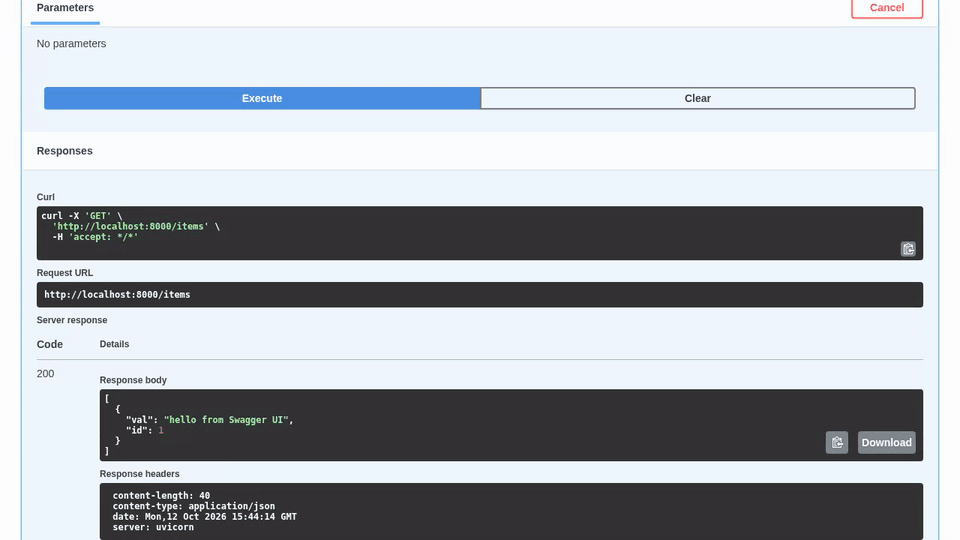
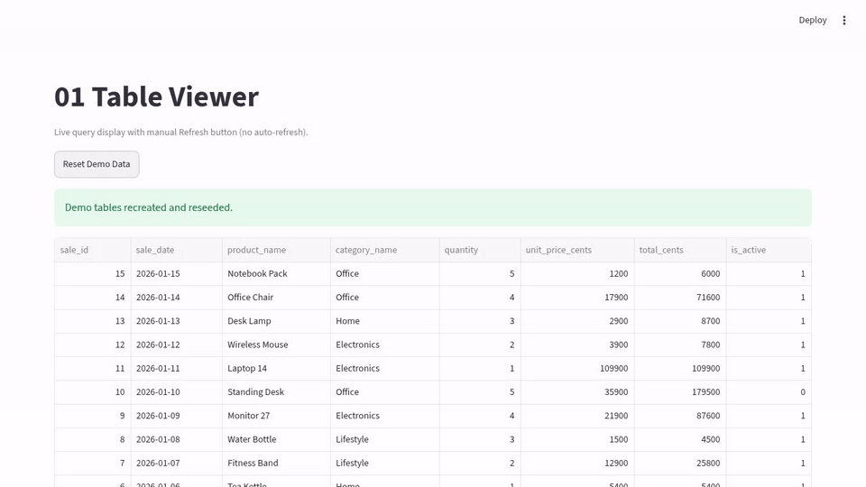

<!-- CUBRID-LAB-ICON:START -->
<p align="center">
  <a href="https://github.com/cubrid-lab/brand"></a>
</p>
<!-- CUBRID-LAB-ICON:END -->

# CUBRID Python Cookbook (한국어)

> 🌐 Translated from [README.md](https://github.com/cubrid-lab/cubrid-cookbook-python/blob/main/README.md) — 한국어는 심사 기간 동안 동기화가 **필수**입니다: README.md가 바뀌면 같은 PR에서 이 파일도 업데이트하세요 (`translation-sync` CI 검사, 보류 시 `translations-deferred` 라벨). English is canonical.


**CUBRID를 위한 프로덕션급 Python 예제 모음** — 첫 연결부터 프로덕션 API까지, 마이그레이션 가이드·성능 패턴·흔한 함정까지 함께 제공합니다.

[](https://github.com/cubrid-lab/cubrid-cookbook-python/blob/main/LICENSE)
[](https://github.com/cubrid-lab/cubrid-cookbook-python/blob/main/SUPPORT_MATRIX.md)
[](https://www.python.org/downloads/)


---

<a href="https://github.com/cubrid-lab/cubrid-cookbook-python/raw/main/docs/demo-agent-state.gif"></a>

<sub>▶ [녹화 재생](https://github.com/cubrid-lab/cubrid-cookbook-python/raw/main/docs/demo-agent-state.gif) (애니메이션 GIF, 9초). 이 페이지의 이미지는 예제를 실제 CUBRID에서 실행해 녹화한 화면의 정지 장면이며, 이미지를 선택하면 녹화가 재생됩니다. 녹화 방법은 [`demos/`](https://github.com/cubrid-lab/cubrid-cookbook-python/blob/main/demos/README.md)를 참고하세요.</sub>

## 시작하기

**CUBRID가 처음이라면 여기서 시작하세요:** [처음 만드는 CUBRID 데이터베이스 (Python)](ko/first-cubrid.md)는
내 컴퓨터에 연습용 데이터베이스를 띄우고, Python에서 접속해 행을 저장하고 읽고,
프레임워크보다 먼저 `commit`, `rollback`, 정리를 보여 줍니다.

| 목표 | 바로 가기 | 소요 시간 |
|------|-----------|-----------|
| **CUBRID가 처음** | [`quickstart/first-cubrid/`](https://github.com/cubrid-lab/cubrid-cookbook-python/tree/main/quickstart/first-cubrid) | Docker와 Python 설치 후 약 15분 |
| **5분 만에 시작** | [`quickstart/5min-fastapi/`](ko/quickstart-fastapi.md) | Docker 설치 후 약 5분 |
| **SQLAlchemy로 시작** | [`quickstart/5min-sqlalchemy/`](ko/quickstart-sqlalchemy.md) | Docker와 Python 설치 후 약 5분 |
| **Java에서 마이그레이션** | [`migration/java-to-python/`](https://github.com/cubrid-lab/cubrid-cookbook-python/tree/main/migration/java-to-python) | 30분 |
| **CUBRIDdb 드라이버에서 pycubrid로 이전** | [`migration/cubriddb-to-pycubrid/`](ko/migration-cubriddb-to-pycubrid.md) | 20분 |
| **프로덕션 API 구축** | [`templates/api-service-fastapi/`](https://github.com/cubrid-lab/cubrid-cookbook-python/tree/main/templates/api-service-fastapi) | 15분 |

---

## 구성

### 퀵스타트

Docker를 설치하고 이미지를 내려받은 뒤라면, Docker로 CUBRID + FastAPI 앱을 5분 정도면 띄웁니다.

```bash
git clone https://github.com/cubrid-lab/cubrid-cookbook-python.git
cd cubrid-cookbook-python/quickstart/5min-fastapi
docker compose up -d --build --wait
curl -sS -X POST localhost:8000/items -H 'Content-Type: application/json' -d '{"val": "hello from the quickstart"}'
# {"val":"hello from the quickstart","id":1}
# http://localhost:8000/docs 접속
```

[FastAPI 빠른 시작](ko/quickstart-fastapi.md)은 단계마다 설명하고, API를 내 컴퓨터에서
Uvicorn으로 실행하는 방법과 멈추고 정리하는 방법도 보여 줍니다.
[SQLAlchemy 빠른 시작](ko/quickstart-sqlalchemy.md)은 Core와 ORM 스크립트 하나로 같은 과정을 안내합니다.

<a href="demo-fastapi.gif"></a>

<sub>▶ [녹화 재생](demo-fastapi.gif) (애니메이션 GIF, 12초)</sub>

### 마이그레이션 가이드

Java JDBC → Python 마이그레이션을 실제 코드 나란히 비교로 제공합니다. 연결, CRUD(DB-API와 ORM), 트랜잭션, 배치 작업을 다룹니다.

> CUBRID의 JDBC 드라이버와 Python 드라이버는 동일한 CAS 프로토콜을 사용합니다 — 데이터 마이그레이션이 필요 없습니다.

이미 Python에서 공식 `CUBRIDdb` C 확장 드라이버를 쓰고 있다면, 별도의
[CUBRIDdb → pycubrid 가이드](ko/migration-cubriddb-to-pycubrid.md)가 드라이버 간 이전을
다룹니다. 연결 인자, autocommit 기본값, 스레드 공유, 파라미터, 오류 속성, LOB를 실행 가능한
pycubrid 레시피 네 개로 보여 주며, 그대로 바꿔 끼우면 된다는(drop-in) 주장은 하지 않습니다.

### 프로덕션 템플릿

실제 애플리케이션의 복사-수정 출발점:

| 템플릿 | 용도 |
|--------|------|
| [`api-service-fastapi/`](https://github.com/cubrid-lab/cubrid-cookbook-python/tree/main/templates/api-service-fastapi) | FastAPI + SQLAlchemy + Docker REST API (12개 레시피) |
| [`flask/`](https://github.com/cubrid-lab/cubrid-cookbook-python/tree/main/templates/flask) | Flask + Flask-SQLAlchemy 패턴 (11개 레시피) |
| [`django/`](https://github.com/cubrid-lab/cubrid-cookbook-python/tree/main/templates/django) | Django 요청 처리 + 실DB로 검증한 SQLAlchemy/CUBRID 브리지 (네이티브 Django ORM 아님) |
| [`async-worker/`](https://github.com/cubrid-lab/cubrid-cookbook-python/tree/main/templates/async-worker) | Celery 백그라운드 작업 처리 |
| [`batch-etl/`](https://github.com/cubrid-lab/cubrid-cookbook-python/tree/main/templates/batch-etl) | Pandas 데이터 파이프라인 |
| [`ai-agent/`](https://github.com/cubrid-lab/cubrid-cookbook-python/tree/main/templates/ai-agent) | AI 에이전트 상태 저장소 + MCP 도구 체인 + RAG 메타데이터 (실제 DB로 검증하는 스크립트 5개) |
| [`dashboard/`](https://github.com/cubrid-lab/cubrid-cookbook-python/tree/main/templates/dashboard) | Streamlit 인터랙티브 대시보드 (`docker compose up` 원커맨드 데모) |

<a href="demo-dashboard.gif"></a>

<sub>▶ [녹화 재생](demo-dashboard.gif) (애니메이션 GIF, 12초)</sub>

### 성능

벤치마크로 뒷받침된 최적화 패턴:

| 패턴 | 효과 |
|------|------|
| [Fetch 최적화](https://github.com/cubrid-lab/cubrid-cookbook-python/tree/main/performance/fetch-optimization) | `fetchall()` vs `fetchone()`, 컬럼 선택, 서버 측 페이지네이션 |
| [벌크 인서트](https://github.com/cubrid-lab/cubrid-cookbook-python/tree/main/performance/bulk-insert) | COMMIT을 배치로 (~28 → ~1,279 rows/s, pycubrid 1.10.0) |
| [커넥션 풀링](https://github.com/cubrid-lab/cubrid-cookbook-python/tree/main/performance/connection-pooling) | 연결 재사용 (쿼리당 ~5.9 ms vs ~0.8 ms, pycubrid 1.10.0) |

### 함정 (Pitfalls)

실제 프로덕션 사고를 일으키는 7가지 반패턴 — 예약어, 오토커밋 차이, 커넥션 누수 등. [`pitfalls/`](https://github.com/cubrid-lab/cubrid-cookbook-python/tree/main/pitfalls) 참고. 예약어 관련 조언은 [`pitfalls/reserved-words/`](https://github.com/cubrid-lab/cubrid-cookbook-python/tree/main/pitfalls/reserved-words)에서 실제 서버로 검증됩니다.

### 기초 (Fundamentals)

핵심 연산별 단계별 참조:

| 주제 | 위치 |
|------|------|
| [연결](https://github.com/cubrid-lab/cubrid-cookbook-python/tree/main/fundamentals/connect) | 기본 연결, 메타데이터, 컨텍스트 매니저 (`fundamentals/pycubrid/01_connect.py`로 리다이렉트) |
| [CRUD](https://github.com/cubrid-lab/cubrid-cookbook-python/tree/main/fundamentals/crud) | 파라미터를 사용한 INSERT/SELECT/UPDATE/DELETE (`fundamentals/pycubrid/02_crud.py`로 리다이렉트) |
| [트랜잭션](https://github.com/cubrid-lab/cubrid-cookbook-python/tree/main/fundamentals/transactions) | 커밋, 롤백, 세이브포인트, 오토커밋 (`fundamentals/pycubrid/03_transactions.py`로 리다이렉트) |
| [파라미터화 쿼리](https://github.com/cubrid-lab/cubrid-cookbook-python/tree/main/fundamentals/parameterized-queries) | 안전한 파라미터 바인딩 (클라이언트 측 — 서버 측 prepare 아님) |
| [에러 처리](https://github.com/cubrid-lab/cubrid-cookbook-python/tree/main/fundamentals/error-handling) | 예외 타입, 재시도 패턴 (`05_error_handling.py`는 `fundamentals/pycubrid/05_error_handling.py`로 리다이렉트) |
| [LOB 처리](https://github.com/cubrid-lab/cubrid-cookbook-python/tree/main/fundamentals/lob-handling) | BLOB/CLOB 연산 (`fundamentals/pycubrid/06_lob.py`로 리다이렉트) |
| [ORM 기초](https://github.com/cubrid-lab/cubrid-cookbook-python/tree/main/fundamentals/orm-basics) | SQLAlchemy 엔진, Core, ORM, 릴레이션십 |
| [pycubrid 드라이버](https://github.com/cubrid-lab/cubrid-cookbook-python/tree/main/fundamentals/pycubrid) | 22개 DB-API 레시피: 커서, 윈도우 함수, 재귀 CTE, 페이지네이션, 타임존/ENUM |
| [SQLAlchemy 레시피](https://github.com/cubrid-lab/cubrid-cookbook-python/tree/main/fundamentals/sqlalchemy) | SET/MULTISET/SEQUENCE 컬렉션 타입 포함 7개 |
| [Pandas](https://github.com/cubrid-lab/cubrid-cookbook-python/tree/main/fundamentals/pandas) | 6개 레시피: read_sql, 청크 읽기, to_sql 적재 |
| [비동기 I/O](https://github.com/cubrid-lab/cubrid-cookbook-python/tree/main/fundamentals/async) | pycubrid.aio와 SQLAlchemy 비동기 엔진 |
| [Alembic 마이그레이션](https://github.com/cubrid-lab/cubrid-cookbook-python/tree/main/fundamentals/alembic) | CubridImpl로 프로그래밍 방식 마이그레이션 |
| [JSON 타입 CRUD](https://github.com/cubrid-lab/cubrid-cookbook-python/tree/main/fundamentals/json) | 네이티브 JSON 컬럼, JSON_EXTRACT/UNQUOTE 패턴 |
| [격리 수준](https://github.com/cubrid-lab/cubrid-cookbook-python/tree/main/fundamentals/isolation-levels) | MVCC 3단계, no-dirty-read 실증 |

---

## 프레임워크 맵

```
pycubrid (DB-API 2.0 드라이버)
├── 직접 사용 ─────── quickstart/first-cubrid (여기서 시작), fundamentals/pycubrid (connect, crud, transactions는 이쪽으로 리다이렉트)
├── SQLAlchemy ────── fundamentals/orm-basics, sqlalchemy, quickstart/5min-sqlalchemy
├── FastAPI ───────── quickstart/5min-fastapi, templates/api-service-fastapi
├── Flask ─────────── templates/flask
├── Django ────────── templates/django
├── Celery ────────── templates/async-worker
├── Pandas ────────── fundamentals/pandas, templates/batch-etl
└── Streamlit ─────── templates/dashboard
```

## 연결 설정

모든 예제는 동일한 CUBRID 인스턴스에 연결합니다:

| 설정 | 값 |
|------|-----|
| 호스트 | `localhost` |
| 포트 | `33000` |
| 데이터베이스 | `testdb` |
| 사용자 | `dba` |
| 비밀번호 | *(비어 있음)* |

```python
# pycubrid (직접)
import pycubrid

conn = pycubrid.connect(host="localhost", port=33000, database="testdb", user="dba")

# SQLAlchemy
from sqlalchemy import create_engine

engine = create_engine("cubrid+pycubrid://dba@localhost:33000/testdb")
```

데이터베이스 시작·중지·삭제(루트 `docker-compose.yml`의 서비스 `cubrid`):

```bash
make docker-up      # CUBRID 시작(CUBRID_VERSION=11.4로 다른 이미지 선택), testdb가 응답할 때까지 대기
make docker-down    # 중지; 데이터베이스는 Docker 볼륨에 남음
make docker-clean   # 파괴적: 컨테이너와 볼륨을 데이터베이스까지 삭제
```

`make up`과 `make down`은 `make docker-up`과 `make docker-down`의 별칭으로 남아 있습니다.
브로커는 `127.0.0.1`에서만 대기합니다. `CUBRID_TEST_PORT`로 다른 호스트 포트에 공개할 수
있지만 예제는 `33000`에 연결하므로, 예제를 실행할 때는 설정하지 마세요.

## 프로젝트 구조

```
cubrid-cookbook-python/
├── quickstart/
│   ├── first-cubrid/          # CUBRID가 처음: pycubrid로 따라 하는 첫 튜토리얼
│   ├── 5min-fastapi/          # 5분 만에 Docker + FastAPI
│   └── 5min-sqlalchemy/       # 5분 만에 Docker + SQLAlchemy
├── migration/
│   ├── java-to-python/        # JDBC → pycubrid/SQLAlchemy 마이그레이션
│   └── cubriddb-to-pycubrid/  # 공식 CUBRIDdb 드라이버 → pycubrid
├── templates/
│   ├── api-service-fastapi/   # 프로덕션 REST API (레시피 12개)
│   ├── flask/                 # Flask + Flask-SQLAlchemy (레시피 11개)
│   ├── django/                # 최소 구성 Django 앱
│   ├── async-worker/          # Celery 백그라운드 작업
│   ├── batch-etl/             # Pandas 데이터 파이프라인
│   ├── ai-agent/              # AI 에이전트 상태 + MCP + RAG (레시피 5개)
│   └── dashboard/             # Streamlit 대시보드 (레시피 5개)
├── performance/
│   ├── fetch-optimization/    # SELECT 튜닝 (벤치마크 포함)
│   ├── bulk-insert/           # 쓰기 배치 처리 (벤치마크 포함)
│   └── connection-pooling/    # 커넥션 풀 설정
├── pitfalls/                  # 흔한 안티패턴 7가지
│   └── reserved-words/        # 실제 DB로 검증한 예약어 레시피
├── fundamentals/
│   ├── connect/               # 연결 기초
│   ├── crud/                  # CRUD 작업
│   ├── transactions/          # 트랜잭션 관리
│   ├── parameterized-queries/   # 파라미터 바인딩 쿼리
│   ├── error-handling/        # 예외 처리 패턴
│   ├── lob-handling/          # BLOB/CLOB
│   ├── orm-basics/            # SQLAlchemy ORM
│   ├── pycubrid/              # pycubrid DB-API 레시피 22개
│   ├── sqlalchemy/            # SQLAlchemy 레시피 7개
│   ├── pandas/                # Pandas 레시피 6개
│   ├── async/                 # pycubrid.aio + 비동기 SQLAlchemy
│   ├── alembic/               # 프로그래밍 방식 Alembic 마이그레이션
│   ├── json/                  # 네이티브 JSON 컬럼 CRUD
│   └── isolation-levels/      # MVCC 격리 수준 3가지
└── docker-compose.yml         # CUBRID 11.2
```

## 관련 프로젝트

- [pycubrid](https://github.com/cubrid-lab/pycubrid) — CUBRID용 순수 Python DB-API 2.0 드라이버
- [sqlalchemy-cubrid](https://github.com/cubrid-lab/sqlalchemy-cubrid) — CUBRID용 SQLAlchemy 2.0/2.1 방언
- [cubrid-mcp-server](https://github.com/cubrid-lab/cubrid-mcp-server) — LLM 클라이언트용 MCP 서버
- [CUBRID](https://www.cubrid.org/) — CUBRID 데이터베이스

## 로드맵

계획된 추가 사항은 [`ROADMAP.md`](https://github.com/cubrid-lab/cubrid-cookbook-python/blob/main/ROADMAP.md)를 참고하세요. 생태계 전체 관점은 [CUBRID Labs Ecosystem Roadmap](https://github.com/cubrid-lab/.github/blob/main/ROADMAP.md)에서 볼 수 있습니다.

## 기여

PR 환영합니다! 각 예제는 자립적으로 실행 가능해야 합니다. [`CONTRIBUTING.md`](https://github.com/cubrid-lab/cubrid-cookbook-python/blob/main/CONTRIBUTING.md) 참고.

### 첫 기여

CUBRID가 처음이신가요? 작업하려는 내용에 맞는 저장소를 선택하세요:

- 문서와 실행 가능한 예제: [cubrid-cookbook-python](https://github.com/cubrid-lab/cubrid-cookbook-python)
- 순수 Python 드라이버 수정: [pycubrid](https://github.com/cubrid-lab/pycubrid)
- SQLAlchemy 방언 수정: [sqlalchemy-cubrid](https://github.com/cubrid-lab/sqlalchemy-cubrid)

대부분의 첫 이슈는 CONTRIBUTING.md의 오프라인 검사만으로 개발하고 테스트할 수 있습니다 — Docker나 CUBRID 서버가 필요 없습니다. 실제 CUBRID 검증은 CI와 메인테이너가 완료할 수 있습니다.

열려 있는 [`good first issue`](https://github.com/cubrid-lab/cubrid-cookbook-python/issues?q=is%3Aissue+is%3Aopen+label%3A%22good+first+issue%22+no%3Aassignee) 작업을 둘러보세요.

## 고지

> 이 프로젝트는 CUBRID 개발자 도구를 위한 독립 오픈소스 이니셔티브인 [CUBRID Lab](https://github.com/cubrid-lab)의 일부이며, CUBRID Corporation 또는 공식 CUBRID 프로젝트와 제휴·후원·보증 관계가 없습니다.

## 라이선스

[MIT](https://github.com/cubrid-lab/cubrid-cookbook-python/blob/main/LICENSE)
